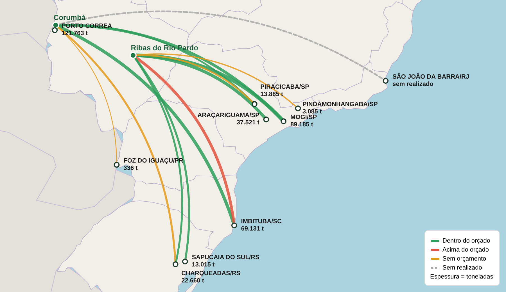

# Mapa de fluxos (origem → destino) no Power BI

Reproduz o visual de referência: arcos curvos entre origens e destinos, **cor = status vs. orçamento**,
**espessura = toneladas**, linha tracejada para "sem realizado", rótulos com toneladas e legenda.

## Opções avaliadas

| Visual | Arcos curvos | Cor por categoria | Espessura por valor | Rótulos customizados | Mapa de fundo | Observação |
|---|---|---|---|---|---|---|
| **Deneb (Vega)** — escolhido | sim | sim | sim | sim (nome + toneladas) | contorno de UFs/países embutido (GeoJSON) | gratuito e **certificado**; não carrega tiles externos |
| Icon Map Pro | sim (curved/geodesic) | sim | sim | parcial | OpenStreetMap (tiles) | pago; o mais próximo do fundo OSM do print |
| Route Map (AppSource) | sim | sim | sim | limitado | tiles (web) | não certificado |
| Flow Map (Weiwei Cui) | sim | por origem | sim | limitado | Bing | sem manutenção ativa |

O Deneb foi escolhido porque é gratuito, certificado e permite reproduzir todos os elementos do visual
(arcos, tracejado, legenda, rótulos de duas linhas). Ele foi testado com a base fictícia `base_ficticia.csv`.

## Como usar no Power BI

1. Em **Obter mais visuais**, instale o **Deneb** (AppSource).
2. Modelo de dados (uma linha por origem → destino):

   | Coluna | Tipo | Exemplo |
   |---|---|---|
   | `Origem` | texto | Corumbá |
   | `LatOrigem` / `LonOrigem` | decimal | -19.009 / -57.653 |
   | `Destino` | texto | IMBITUBA/SC |
   | `LatDestino` / `LonDestino` | decimal | -28.240 / -48.670 |
   | `Realizado_t` | medida ou coluna (soma) | 29131 |
   | `Orcado_t` | medida ou coluna (soma) | 25000 |

   Os campos precisam ter **exatamente esses nomes**. Se os nomes forem outros, renomeie no painel *Valores* do visual.
3. Adicione o Deneb, arraste todos os campos em *Values* e, para lat/lon, escolha **Não resumir**.
4. Clique em **Editar** → *Create new specification* → **Vega** (não Vega-Lite) → *Empty*.
5. Substitua todo o conteúdo pelo arquivo `deneb_spec_fluxos.json` → **Aplicar**.

### Regras de status (calculadas dentro da spec)

| Status | Regra | Estilo |
|---|---|---|
| Sem realizado | Realizado = 0 e Orçado > 0 | cinza tracejado |
| Sem orçamento | Orçado vazio/0 | laranja |
| Acima do orçado | Realizado > Orçado | vermelho |
| Dentro do orçado | demais casos | verde |

Para mudar cores, ajuste o `range` da escala `cor`. A curvatura dos arcos fica no sinal `curvatura` (0.22).
A faixa de espessura fica no `range` da escala `espessura` ([1, 9] px).

O enquadramento é automático: o mapa se ajusta aos pontos do filtro atual, com margem à direita para os rótulos.

## Arquivos

- `deneb_spec_fluxos.json`: spec pronta para colar no Deneb (GeoJSON das UFs e dos países vizinhos já embutido).
- `base_ficticia.csv`: base de teste (separador `;`).
- `gerar_spec.cjs`: gera a spec a partir dos GeoJSON em `geo/`. Use-o se quiser trocar o mapa de fundo.
- `testar_no_navegador.cjs`: renderiza a spec com a base fictícia no Chromium (motor do Power BI Desktop).
  Precisa de `vega@5` e `playwright`. Uso: `node testar_no_navegador.cjs 900 520 saida.png`.
- `teste/`: imagens geradas no teste.

## Limitações

- O Deneb (certificado) não baixa tiles do OpenStreetMap. O fundo é vetorial (UFs + vizinhos), sem nomes de cidades nem relevo.
  Se precisar do fundo OSM idêntico ao print, use o **Icon Map Pro**, que tem linhas curvas, cor e largura por campo.
- Rótulos: o transform `label` do Vega evita sobreposições. Quando não acha posição livre, coloca o rótulo à direita do ponto.
  Em destinos muito próximos ainda pode haver encostamento leve.
